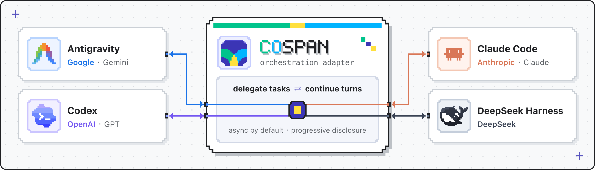

<p align="center"></p>

<p align="center"><a href="README.md">English</a> | <a href="README.zh-CN.md">Simplified Chinese</a></p>

<p align="center">
  <a href="https://antigravity.google/product/antigravity-cli"></a> <a href="https://developers.openai.com/codex/"></a><br>
  <a href="https://claude.com/claude-code"></a> <a href="#install"></a><br>
  <a href="LICENSE"></a>
</p>

**Orchestrate every model in its native harness.**
Unified async delegation across **Antigravity**, **Codex**, **Claude Code**, **DeepSeek Harness**, and more harnesses coming soon.

[](assets/design.svg)

**[Why Cospan](#why-cospan) · [Core CUJs](#core-cujs) · [Install](#install) · [Harnesses](#harnesses) · [References](#references)**

## Why Cospan

Frontier coding models perform best inside the native harnesses they were co-trained with—so the real unit of orchestration is **`Model × Harness`**, and different ecosystems bring distinct strengths: **Gemini 4 Carbon** (`agy`) for architecture and planning, **GPT-6.2-Sol** (`codex`) for deep bug-hunting review, **GPT-6.1-Terra** (`codex`) for live GUI and browser computer use, and **Claude** (`claude`) for frontend craft. Combining them unlocks massive leverage; humans can bridge harnesses manually with handoff prompts today, but orchestration belongs to the agents themselves.

Inspired and battle-tested by [`agy-staff`](https://github.com/keli-wen/agy-staff), Cospan turns cross-harness delegation into an **async, progressively disclosed protocol** behind one unified adapter: your host dispatches peer `Model × Harness` units in the background, stays unblocked with a clean context window, and pulls live status or full execution traces only when needed—forming a clean foundation for next-generation multi-agent collaboration.


## Core CUJs

### Basic dispatch &amp; unified live sidebar

<table>
  <tr>
    <td valign="top" width="54%">
      <p>Invoke <code>/cospan-&lt;harness&gt;</code> (or <code>/cospan:&lt;harness&gt;</code> in Claude Code, <code>$cospan:&lt;harness&gt;</code> in Codex) and specify any target <strong>model</strong>, <strong>reasoning effort</strong>, or <strong>timeout</strong> right in your prompt:</p>
      <pre><code>/cospan-codex Use sol (high effort, 20m timeout) to review src/webhook/ and flag real edge cases.</code></pre>
      <p><strong>Handled automatically under the hood:</strong></p>
      <ul>
        <li>Frames context inline or via <code>--prompt-file</code> and launches detached background workers (<code>send</code>).</li>
        <li>Tracks progress non-blockingly (<code>wait</code> / bounded <code>observe</code>) while keeping your main context window clean.</li>
        <li>Resumes the same session (<code>continue</code>) for multi-turn follow-ups.</li>
        <li>Installing on <strong>Antigravity (<code>agy</code>)</strong> or <strong>DeepSeek Harness (<code>dsh</code>)</strong> enables this live sidebar panel for cross-harness monitoring, Q&amp;A inspection, and Git worktree (<code>wt:*</code>) aggregation.</li>
      </ul>
      <p><a href="#install">Jump to Install →</a></p>
    </td>
    <td align="center" valign="middle" width="46%">
      
    </td>
  </tr>
</table>

### Cross-ecosystem workflows

- **Parallel `Sol` slice reviews from `Carbon`** (`Antigravity` → `2× Codex`) — Split deep code reviews across modules without blocking local tests; staggered async results merge cleanly on wakeup:

  > `/cospan-codex` _"Fan out 2 `sol` reviews across `webhook/` and `retry/` for real bugs."_

  

- **Multi-turn `Carbon` second brain for `Astra`** (`Codex` ⇄ `Antigravity`) — Stress-test migration plans against a second model family and follow up in the same session while staying unblocked locally:

  > `$cospan:agy` _"Ask `carbon` to stress-test `docs/plan.md`, propose a cleaner route, and verify crash recovery."_

  

- **Delegate GUI computer use from `Claude Code` to `Terra`** (`Claude Code` → `Codex`) — Keep code and unit-test orchestration in **Claude Sonnet**, while **GPT-6.1-Terra** drives the live browser to catch layout bugs:

  > `/cospan:codex` _"Have `terra` open the local app and walk through the checkout coupon flow."_

  

- **Parallel cross-ecosystem sidecars for `Fable`** (`Claude Code` → `Antigravity` + `DeepSeek Harness`) — Protect scarce flagship context and quota by offloading repo surveys and concurrency checks simultaneously:

  > _"Map auth token refresh with `hydrogen` and verify 401 race conditions with `v4.1-flash`."_

  

- **End-to-end research & review topology from `Carbon` host** (`Antigravity` ⇄ `Codex` + `×N Antigravity`) — Drive a full plan → gate → bulk experiment → final audit → fix pass topology from **Gemini 4 Carbon** across **Astra**, **Hydrogen ×N**, and **Sol**:

  > _"Have `astra` review my spec, fan out `hydrogen` across all experiment configs, audit with `sol`, and send `sol`'s fixes back to `hydrogen` for one final pass."_

  

## Install

Requires **Node.js `>= 20`** plus the CLIs for whichever harnesses you want to connect (`agy`, `claude`, `codex`, `dsh`). Install the native plugin into the harness(es) you drive from:

**Antigravity (`agy`)**

```bash
git clone https://github.com/keli-wen/cospan.git ~/.cospan/repo
node ~/.cospan/repo/bin/cospan.mjs install --host agy
```

**Claude Code (`claude`)**

```bash
claude plugin marketplace add keli-wen/cospan
claude plugin install cospan@cospan
```

**OpenAI Codex (`codex`)**

```bash
codex plugin marketplace add https://github.com/keli-wen/cospan
codex plugin add cospan@cospan
```

**DeepSeek Harness (`dsh`)**

```bash
dsh plugin --profile desktop add github:keli-wen/cospan
```

_(Or in the DeepSeek Harness desktop app: **Plugins** → install from `github:keli-wen/cospan`.)_

Restart Claude Code or Codex afterwards so the plugin loads (`/cospan-…` in Antigravity and DeepSeek Harness, `/cospan:…` in Claude Code, `$cospan:…` in Codex—or describe what you want in plain language).

## Harnesses

| Harness                      | Ecosystem                   | Built-in model shortcuts                                       |
| ---------------------------- | --------------------------- | -------------------------------------------------------------- |
| **Antigravity** (`agy`)      | Google · Gemini & Claude    | `flash`, `carbon`, `argon`, `hydrogen`, `opus`, `sonnet`       |
| **Codex** (`codex`)          | OpenAI · GPT                | `sol`, `terra`, `astra`, `luna`                                |
| **Claude Code** (`claude`)   | Anthropic · Claude          | `sonnet`, `opus`, `haiku`, `fable`                             |
| **DeepSeek Harness** (`dsh`) | DeepSeek & custom providers | `v4.1-flash` / `flash`, `v4-pro` / `pro`, `<provider>/<model>` |

_More harnesses are on the way—Cospan's driver layer is designed to plug in additional coding agent CLIs cleanly._

## References

- **[`agy-staff`](https://github.com/keli-wen/agy-staff)** — Hire Google's Antigravity CLI (`agy`) as a fast worker and second brain across Claude Code, Codex, DeepSeek Harness, Pi, and OpenCode. Cospan generalizes the async `jobs` protocol and progressive disclosure architecture first pioneered and benchmarked in `agy-staff` ([Bench v1 Tech Report](https://lastwhisper.dev/en/zen-of-harness-engineering/agy-staff-bench-v1/)).

## License

MIT © 2026 Keli Wen · Architecture & contributor guide in [`AGENTS.md`](AGENTS.md).
