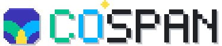
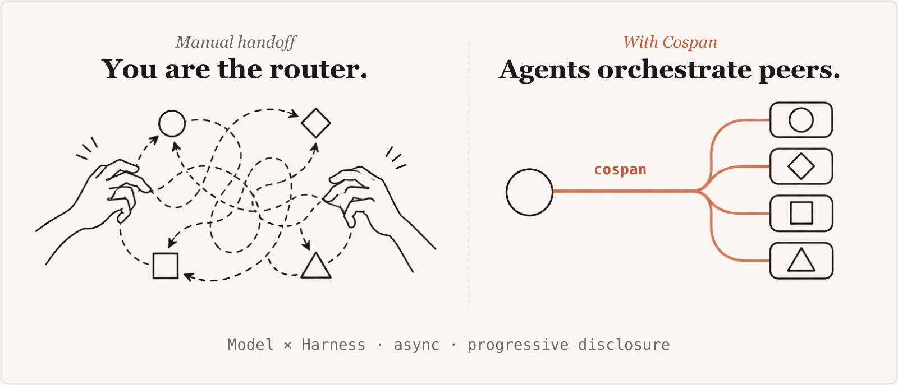

<p align="center"></p>

<p align="center"><a href="README.md">English</a> | <a href="README.zh-CN.md">Simplified Chinese</a></p>

<p align="center">
  <a href="https://antigravity.google/product/antigravity-cli"></a> <a href="https://developers.openai.com/codex/"></a> <a href="https://claude.com/claude-code"></a> <a href="#install"></a><br>
  <a href="LICENSE"></a>
</p>

**Orchestrate every model in its native harness.**
Unified async delegation across **Antigravity**, **Codex**, **Claude Code**, **DeepSeek Harness**, and more harnesses coming soon.

[](assets/design.svg)

**[Why Cospan](#why-cospan) · [Core CUJs](#core-cujs) · [Install](#install) · [Harnesses](#harnesses) · [References](#references)**

## Why Cospan

Frontier coding models perform best inside the native harnesses they were co-trained with—so the real unit of orchestration is **`Model × Harness`**, and different ecosystems bring distinct strengths: **Gemini 4 Carbon** (`agy`) for architecture and planning, **GPT-6.2-Sol** (`codex`) for deep bug-hunting review, **GPT-6.1-Terra** (`codex`) for live GUI and browser computer use, and **Claude** (`claude`) for frontend craft. Combining them unlocks massive leverage; humans can bridge harnesses manually with handoff prompts today, but orchestration belongs to the agents themselves.

Inspired and battle-tested by [`agy-staff`](https://github.com/keli-wen/agy-staff), Cospan turns cross-harness delegation into an **async, progressively disclosed protocol** behind one unified adapter: your host dispatches peer `Model × Harness` units in the background, stays unblocked with a clean context window, and pulls live status or full execution traces only when needed—forming a clean foundation for next-generation multi-agent collaboration.



## Core CUJs

### Basic dispatch: one command, zero plumbing

Invoke `/cospan-<harness>` (or `/cospan:<harness>` in Claude Code, `$cospan:<harness>` in Codex) and specify any target **model**, **reasoning effort**, or **timeout** right in your prompt:

```text
/cospan-codex Use sol (high effort, 20m timeout) to review src/webhook/ and flag real edge cases.
```

> [!TIP]
> **Handled automatically under the hood (no need to manage this yourself):** Your host agent autonomously frames context (inline text or `--prompt-file`), launches a detached background session (`send`), monitors progress non-blockingly (`wait` / bounded `observe`, inspecting full trajectory logs only if needed), and collects the result—or resumes the same session (`continue`) for follow-up turns.

### Cross-ecosystem workflows

- **Build with `Carbon`, fan out parallel `Sol` reviews** (`Antigravity` → `2× Codex`) — Finish coding on **Gemini 4 Carbon**, then fan out multiple **GPT-6.2-Sol** reviewers across slices (`webhook/` & `retry/`) without blocking your host—Carbon keeps running local tests while staggered background results merge cleanly on wakeup:

  > `/cospan-codex` _"Fan out 2 `sol` reviews across `webhook/` and `retry/` for real bugs."_

  

- **Bring in `Carbon` as a second brain for `Astra`** (`Codex` ⇄ `Antigravity`) — Driving a complex migration on **GPT-6.2-Astra** in Codex? Consult **Gemini 4 Carbon** from a second model family to stress-test assumptions, propose an alternative route, and verify edge cases across multiple turns in the same session:

  > `$cospan:agy` _"Ask `carbon` to stress-test `docs/plan.md`, propose a cleaner route, and verify crash recovery."_

  

- **Delegate computer use from `Claude Code` to `Terra`** (`Claude Code` → `Codex`) — Keep main code orchestration in **Claude Code**, and hand off live browser or GUI computer-use workflows to **GPT-6.1-Terra** while Claude keeps writing unit tests locally:

  > `/cospan:codex` _"Have `terra` open the local app and walk through the checkout coupon flow."_

  

- **Offload parallel cross-ecosystem sidecars** (`Claude Code` → `Antigravity` + `DeepSeek Harness`) — Protect scarce flagship context and quota (like **Claude Fable**) by fanning out fast repo surveys to **Gemini 4 Hydrogen** and independent concurrency checks to **DeepSeek V4.1 Flash** simultaneously:

  > _"Map auth token refresh with `hydrogen` and verify 401 race conditions with `v4.1-flash`."_

  

## Install

Requires **Node.js `>= 20`** plus the CLIs for whichever harnesses you want to connect (`agy`, `claude`, `codex`, `dsh`). Install the native plugin into the harness(es) you drive from:

**Antigravity (`agy`)**

```bash
git clone https://github.com/keli-wen/cospan.git ~/.cospan/repo
node ~/.cospan/repo/bin/cospan.mjs install --host agy
```

**Claude Code (`claude`)**

```bash
claude plugin marketplace add keli-wen/cospan
claude plugin install cospan@cospan
```

**OpenAI Codex (`codex`)**

```bash
codex plugin marketplace add https://github.com/keli-wen/cospan
codex plugin add cospan@cospan
```

**DeepSeek Harness (`dsh`)**

```bash
dsh plugin --profile desktop add github:keli-wen/cospan
```

_(Or in the DeepSeek Harness desktop app: **Plugins** → install from `github:keli-wen/cospan`.)_

Restart Claude Code or Codex afterwards so the plugin loads (`/cospan-…` in Antigravity and DeepSeek Harness, `/cospan:…` in Claude Code, `$cospan:…` in Codex—or describe what you want in plain language).

## Harnesses

| Harness                      | Ecosystem                   | Built-in model shortcuts                                       |
| ---------------------------- | --------------------------- | -------------------------------------------------------------- |
| **Antigravity** (`agy`)      | Google · Gemini & Claude    | `flash`, `carbon`, `argon`, `hydrogen`, `opus`, `sonnet`       |
| **Codex** (`codex`)          | OpenAI · GPT                | `sol`, `terra`, `astra`, `luna`                                |
| **Claude Code** (`claude`)   | Anthropic · Claude          | `sonnet`, `opus`, `haiku`, `fable`                             |
| **DeepSeek Harness** (`dsh`) | DeepSeek & custom providers | `v4.1-flash` / `flash`, `v4-pro` / `pro`, `<provider>/<model>` |

_More harnesses are on the way—Cospan's driver layer is designed to plug in additional coding agent CLIs cleanly._

## References

- **[`agy-staff`](https://github.com/keli-wen/agy-staff)** — Hire Google's Antigravity CLI (`agy`) as a fast worker and second brain across Claude Code, Codex, DeepSeek Harness, Pi, and OpenCode. Cospan generalizes the async `jobs` protocol and progressive disclosure architecture first pioneered and benchmarked in `agy-staff` ([Bench v1 Tech Report](https://lastwhisper.dev/en/zen-of-harness-engineering/agy-staff-bench-v1/)).

## License

MIT © 2026 Keli Wen · Architecture & contributor guide in [`AGENTS.md`](AGENTS.md).
