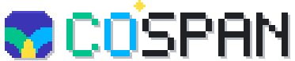
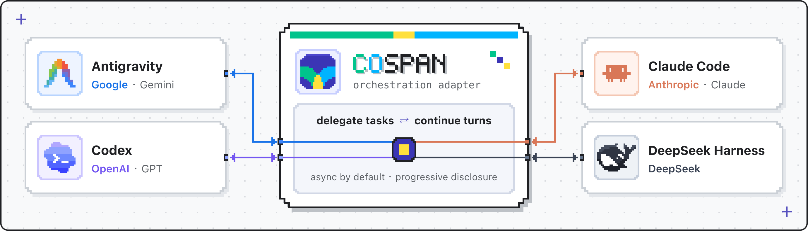
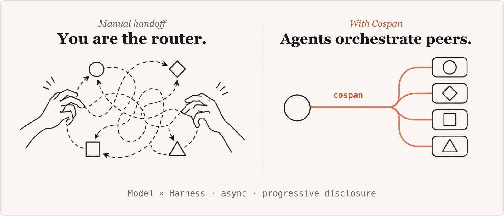
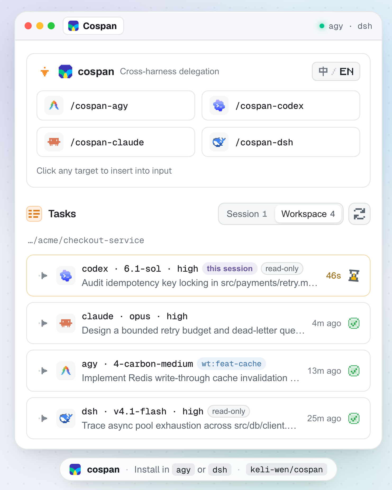

<p align="center"></p>

<p align="center"><a href="README.md">English</a> | <a href="README.zh-CN.md">简体中文</a></p>

<p align="center">
  <a href="https://antigravity.google/product/antigravity-cli"></a> <a href="https://developers.openai.com/codex/"></a><br>
  <a href="https://claude.com/claude-code"></a> <a href="#安装"></a><br>
  <a href="LICENSE"></a>
</p>

**让每个模型留在最强的原生 Harness，由 Agent 自主编排彼此。**
连接 **Antigravity**、**Codex**、**Claude Code**、**DeepSeek Harness**（更多 Harness 持续支持中）的统一异步编排适配器。

[](assets/design.svg)

**[核心理念](#核心理念) · [核心场景](#核心场景) · [安装](#安装) · [支持生态](#支持生态) · [参考与致谢](#参考与致谢)**

## 核心理念

多智能体编排（Agent Orchestration）具备极高的杠杆率——前沿模型往往在与自身协同训练的原生 Harness 中表现最强，因此真正应该被调度的基本单元是 **`Model × Harness`**。不同模型家族各有鲜明长板：**Gemini 4 Carbon**（`agy`）擅长架构与规划，**GPT-6.2-Sol**（`codex`）擅长深度查错 Review，**GPT-6.1-Terra**（`codex`）擅长结合 Codex 跑 Computer Use，而 **Claude** 家族（`claude`）擅长前端设计与交互打磨。今天人们还能靠 Handoff Prompt 在不同窗口间手工传话，但未来的趋势必然是让 Agent 自主完成跨端委派与协同。

受 [`agy-staff`](https://github.com/keli-wen/agy-staff) 的实践验证与**渐进式披露（Progressive Disclosure）**启发，Cospan 通过一个统一的编排适配器提供**默认异步、按需展开**的协议工具：Host Agent 可统一在后台非阻塞调度其他 `Model × Harness` 单元，平时只收回精炼结论，仅在需要时按需拉取实时进展与完整轨迹——构建下一代多智能体编排与协作的基础设施。



## 核心场景

### 基础用法与统一侧边栏面板

<table>
  <tr>
    <td valign="top" width="54%">
      <p>直接通过 <code>/cospan-&lt;harness&gt;</code>（Claude Code 中为 <code>/cospan:&lt;harness&gt;</code>，Codex 中为 <code>$cospan:&lt;harness&gt;</code>）即可指定目标<strong>模型</strong>、<strong>推理强度（effort）</strong>与<strong>超时时间（timeout）</strong>：</p>
      <pre><code>/cospan-codex 用 sol（high effort，20m 超时）审查 src/webhook/ 的改动，找出真正的边界 Bug。</code></pre>
      <p><strong>底层全自动接管（无需手动干预）：</strong></p>
      <ul>
        <li>自主选择内联文本或 <code>--prompt-file</code> 组织上下文，并在后台非阻塞发起会话（<code>send</code>）。</li>
        <li>通过 <code>wait</code> / 定界 <code>observe</code> 持续跟踪进度，保持主对话上下文清爽。</li>
        <li>收回结论后可直接沿原会话 <code>continue</code> 多轮追问。</li>
        <li>在 <strong>Antigravity（<code>agy</code>）</strong> 或 <strong>DeepSeek Harness（<code>dsh</code>）</strong> 中安装后同步启用右侧统一侧边栏——实时追踪后台任务、展开问答结果并聚合 Git worktree（<code>wt:*</code>）。</li>
      </ul>
      <p><a href="#安装">前往安装 →</a></p>
    </td>
    <td align="center" valign="middle" width="46%">
      
    </td>
  </tr>
</table>

### 跨生态多智能体工作流

- **用 `Carbon` 主导开发，并发扇出多个 `Sol` 分片审查**（`Antigravity` → `2× Codex`）— 按模块拆分深度 Review 且不阻塞本地跑单测，错峰完成后自动唤醒汇总：

  > `/cospan-codex` _“并发派 2 个 `sol` 分别审查 `webhook/` 与 `retry/` 的改动，找出真正的 Bug。”_

  

- **在 `Astra` 中引入 `Carbon` 作为多轮第二大脑**（`Codex` ⇄ `Antigravity`）— 借助另一模型家族挑刺方案并在同一会话内二次追问验证，同时主端保持本地推进：

  > `$cospan:agy` _“请 `carbon` 挑一挑 `docs/plan.md` 方案盲点、给出更优路线，并继续验证崩溃恢复。”_

  

- **在 `Claude Code` 中把 Computer Use 交给 `Terra`**（`Claude Code` → `Codex`）— 主线留在 **Claude Sonnet** 统筹编码与单测，将真实浏览器交互排查非阻塞委派给 **GPT-6.1-Terra**：

  > `/cospan:codex` _“让 `terra` 打开本地应用，实际走一遍结账优惠券流程并检查界面状态。”_

  

- **跨生态高速分流，节省 `Fable` 旗舰额度**（`Claude Code` → `Antigravity` + `DeepSeek Harness`）— 将代码摸底与竞态核验同时分流给两款高速跨生态侧翼模型，主对话零探索刷屏：

  > _“让 `hydrogen` 快速梳理鉴权刷新入口，同时让 `v4.1-flash` 核查并发 401 下的锁竞态。”_

  

- **以 `Carbon` 为 Host 的端到端研究与审校闭环拓扑**（`Antigravity` ⇄ `Codex` + `×N Antigravity`）— 由 **Gemini 4 Carbon** 作为主控，串联 **Astra** 方案审查、**Hydrogen ×N** 大批量并行实验、**Sol** 最终审计，并把审查建议交由 **Hydrogen** 完成最后一遍收口：

  > _“先让 `astra` 审查我的方案，再并行扇出 `hydrogen` 跑完各组实验，接着让 `sol` 做最终审查，并把 `sol` 的建议交回 `hydrogen` 过最后一遍。”_

  

## 安装

只需 **Node.js `>= 20`** 以及你想连接的任意 Agent CLI（`agy`、`claude`、`codex`、`dsh`）。在你日常使用的主力客户端中通过原生插件命令安装即可：

**Antigravity (`agy`)**

```bash
git clone https://github.com/keli-wen/cospan.git ~/.cospan/repo
node ~/.cospan/repo/bin/cospan.mjs install --host agy
```

**Claude Code (`claude`)**

```bash
claude plugin marketplace add keli-wen/cospan
claude plugin install cospan@cospan
```

**OpenAI Codex (`codex`)**

```bash
codex plugin marketplace add https://github.com/keli-wen/cospan
codex plugin add cospan@cospan
```

**DeepSeek Harness (`dsh`)**

```bash
dsh plugin --profile desktop add github:keli-wen/cospan
```

_（也可直接在 DeepSeek Harness 桌面端侧边栏 **Plugins** 中输入 `github:keli-wen/cospan` 安装。）_

安装完成后重启 Claude Code 或 Codex 即可加载插件（Antigravity 与 DeepSeek Harness 中为 `/cospan-…`，Claude Code 中为 `/cospan:…`，Codex 中为 `$cospan:…`，或直接用自然语言描述需求）。

## 支持生态

| Agent 客户端                 | 模型生态                 | 内置模型简写                                                   |
| ---------------------------- | ------------------------ | -------------------------------------------------------------- |
| **Antigravity** (`agy`)      | Google · Gemini & Claude | `flash`, `carbon`, `argon`, `hydrogen`, `opus`, `sonnet`       |
| **Codex** (`codex`)          | OpenAI · GPT             | `sol`, `terra`, `astra`, `luna`                                |
| **Claude Code** (`claude`)   | Anthropic · Claude       | `sonnet`, `opus`, `haiku`, `fable`                             |
| **DeepSeek Harness** (`dsh`) | DeepSeek 及自定义提供商  | `v4.1-flash` / `flash`, `v4-pro` / `pro`, `<provider>/<model>` |

_更多 Harness 正在持续接入中——Cospan 的驱动层架构支持平滑扩展更多编程 Agent CLI。_

## 参考与致谢

- **[`agy-staff`](https://github.com/keli-wen/agy-staff)** — 将 Google Antigravity CLI（`agy`）作为高速执行者与第二大脑接入 Claude Code、Codex、DeepSeek Harness、Pi 与 OpenCode。Cospan 将 `agy-staff` 中率先实践并完成基准评测（[Bench v1 技术报告](https://lastwhisper.dev/zen-of-harness-engineering/agy-staff-bench-v1/)）的异步 `jobs` 协议与渐进式披露机制推广为通用的跨生态双向编排基础设施。

## 许可证

MIT © 2026 Keli Wen · 架构与工程规范见 [`AGENTS.md`](AGENTS.md)。
